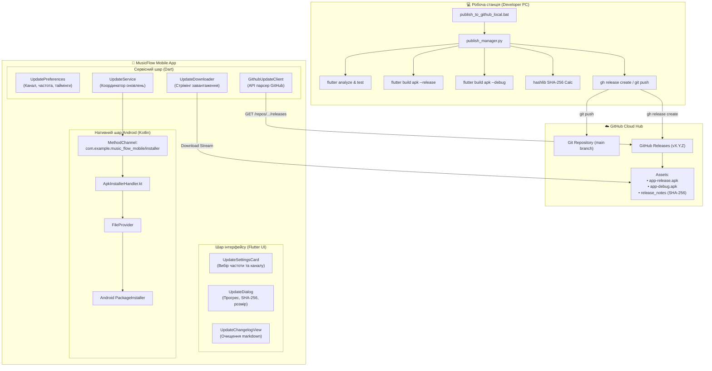
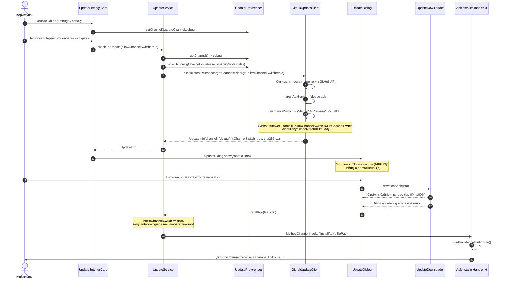
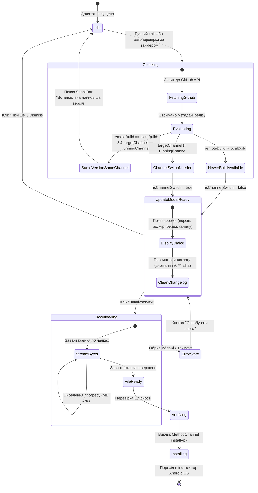

# 🚀 Архітектура та UML-специфікація системи оновлень MusicFlow Mobile

Цей документ містить повний технічний опис підсистеми оновлень, діаграми взаємодії компонентів (UML), логіку перемикання каналів (Release / Debug) та покроковий інженерний план для координації релізів.

---

## 1. Загальна компонентна архітектура (UML Component Diagram)

Система оновлень складається з трьох ключових середовищ:
1. **Developer Environment (Робоча станція):** локальний менеджер релізів, Flutter SDK, Java 17 LTS, Gradle.
2. **Distribution Hub (GitHub Releases):** хмарне сховище бінарників APK (`app-release.apk`, `app-debug.apk`), тегів і контрольних сум SHA-256.
3. **Mobile Client (Мобільний додаток):** Flutter-шар перевірки/завантаження + Kotlin Native шар взаємодії з Android OS.



---

## 2. Діаграма послідовності випуску релізу (UML Sequence: Release Pipeline)

Ця діаграма показує, як скрипт `publish_manager.py` автономно верифікує та публікує версію на GitHub.

```mermaid
sequenceDiagram
    autonumber
    actor Dev as Розробник
    participant Script as publish_manager.py
    participant Flutter as Flutter & Gradle
    participant Git as Git CLI
    participant GH as GitHub CLI (gh)
    participant Cloud as GitHub API & CDN

    Dev->>Script: Запуск через publish_to_github_local.bat
    Script->>Script: Налаштування Java 17 LTS (Adoptium)
    Script->>Script: Читання pubspec.yaml та розрахунок vX.Y.Z+Build
    Script->>Git: git log (генерація автоматичного опису змін)
    
    rect rgb(20, 35, 20)
        note over Script,Flutter: Фаза перевірки якості коду
        Script->>Flutter: flutter analyze
        Flutter-->>Script: 0 помилок (0 issues)
        Script->>Flutter: flutter test
        Flutter-->>Script: 63/63 тестів успішно
    end

    rect rgb(35, 30, 20)
        note over Script,Flutter: Фаза бінарної збірки
        Script->>Flutter: flutter build apk --release
        Flutter-->>Script: build/.../app-release.apk
        Script->>Flutter: flutter build apk --debug
        Flutter-->>Script: build/.../app-debug.apk
    end

    Script->>Script: Розрахунок хешів SHA-256 для обох APK

    rect rgb(20, 30, 45)
        note over Script,Cloud: Фаза публікації та гітінгу
        Script->>Git: git add pubspec.yaml && git commit
        Script->>Git: git push origin main
        alt Мережева помилка (Could not resolve host)
            Git-->>Script: fatal: unable to access github.com
            Script-->>Dev: [ПОМИЛКА МЕРЕЖІ] Збірка збережена локально, потрібен retry!
        else Успішний зв'язок
            Git-->>Script: 200 OK pushed
            Script->>GH: gh release create vX.Y.Z app-release.apk app-debug.apk -F notes.txt
            GH->>Cloud: Upload assets & Publish
            Cloud-->>GH: Реліз опубліковано
            GH-->>Script: Успіх
            Script-->>Dev: Реліз vX.Y.Z доступний для оновлення!
        end
    end
```



---

## 3. Діаграма послідовності перевірки та перемикання каналів у додатку (UML Sequence: Client In-App Updater)

Діаграма демонструє логіку, коли на телефоні встановлено **Release**, а користувач обирає **Debug** (або навпаки).



---

## 4. Діаграма станів клієнта оновлень (UML State Machine)



---

## 5. Матриця рішень: Поведінка Update Engine

Ця таблиця визначає точну логіку, яку виконує клієнт за будь-яких умов:

| Поточний встановлений додаток | Обраний канал у налаштуваннях | Версія на GitHub | Результат перевірки | UI повідомлення |
|---|---|---|---|---|
| **Release** (v0.1.2) | **Release** | v0.1.2 | `info = null` | "У вас встановлена найновіша версія! 🎉" |
| **Release** (v0.1.2) | **Release** | v0.1.3 | `info != null` (`isChannelSwitch: false`) | Діалог: "Нове оновлення! v0.1.3 (RELEASE)" |
| **Release** (v0.1.2) | **Debug** | v0.1.2 | `info != null` (`isChannelSwitch: true`) | Діалог: **"Зміна каналу (DEBUG)"** (217 MB) |
| **Debug** (v0.1.2) | **Release** | v0.1.2 | `info != null` (`isChannelSwitch: true`) | Діалог: **"Зміна каналу (RELEASE)"** (66 MB) |
| **Debug** (v0.1.2) | **Debug** | v0.1.2 | `info = null` | "У вас встановлена найновіша версія! 🎉" |
| Будь-який | Будь-який | Немає мережі / DNS помилка | `info = null` (із записом у лог) | Тихий fallback без падіння додатку |

---

## 6. Інженерний протокол дій (Operational Playbook для координатора)

### Випадок: Помилка мережі при релізі (`Could not resolve host: github.com`)
У лозі розробника видно:
```
fatal: unable to access 'https://github.com/...': Could not resolve host: github.com
error connecting to api.github.com
```
**Чому це сталося:**
Скрипт успішно виконав `flutter analyze`, всі тести, збірку `app-release.apk` і `app-debug.apk`, і створив локальний коміт версії. Але в момент звернення до серверів GitHub зник інтернет або підвів DNS-сервер Windows.

**Як завершити публікацію за 1 хвилину без перезбірки:**
Коли інтернет активний:
1. Запустити пуш накопиченого коміту:
   ```powershell
   git push origin main
   ```
2. Опублікувати вже готові зібрані APK однією командою через GitHub CLI:
   ```powershell
   gh release create v0.1.2 build\app\outputs\flutter-apk\app-release.apk build\app\outputs\flutter-apk\app-debug.apk --title "MusicFlow v0.1.2 (build 3)" --notes "### 📦 Оновлення MusicFlow Mobile v0.1.2`n`n* Покращення системи оновлень та очищення чейнджлогу"
   ```
3. Або просто повторно запустити `publish_to_github_local.bat` при відновленні з'єднання.
