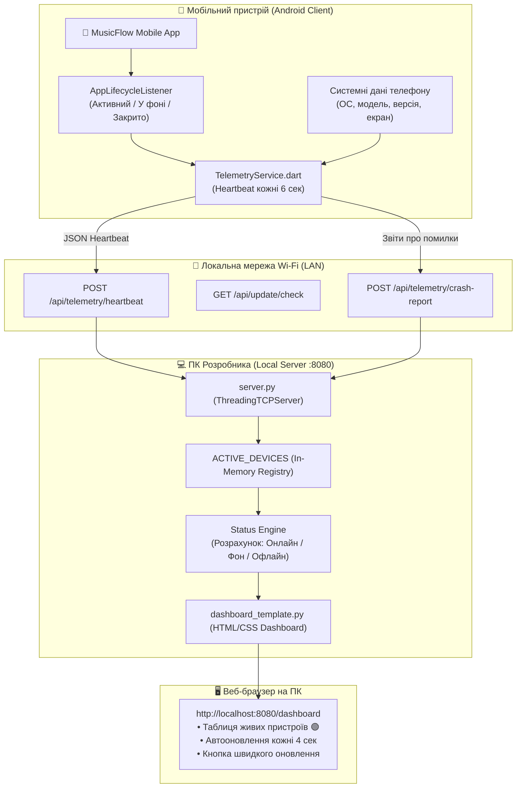
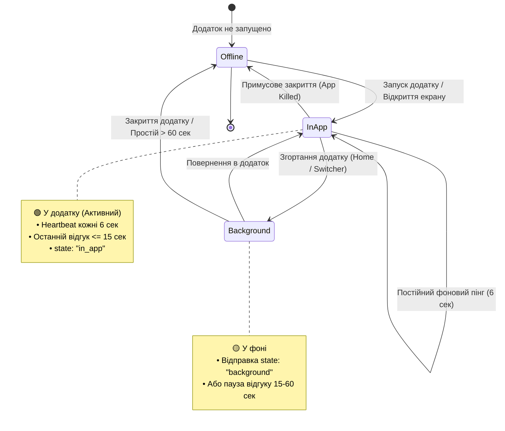

# 📡 Схема системи локального сервера та моніторингу додатків MusicFlow

Цей документ містить повну архітектурну схему, опис протоколу зв'язку та діаграми станів прямої взаємодії між мобільним додатком **MusicFlow Mobile** та локальним сервером розробника.

---

## 1. Загальна архітектурна схема (System Architecture)

Система побудована на принципі **прямого клієнт-серверного зв'язку** по локальній мережі Wi-Fi. Сервер фіксує та відображає виключно ті пристрої, на яких реально встановлено і запущено додаток MusicFlow.



---

## 2. Діаграма станів життєвого циклу (Device State Machine)

Статус пристрою на дашборді повністю залежить від стану додатку на телефоні в реальному часі:



---

## 3. Матриця статусів на Веб-Дашборді

| Статус | Бейдж на Дашборді | Умова відображення | Опис |
|---|:---:|---|---|
| **Активний** | 🟢 **У додатку (Активний)** | Останній heartbeat `< 15 сек` та `state == "in_app"` | Користувач взаємодіє з додатком прямо зараз |
| **Згорнуто** | 🟡 **У фоні** | `state == "background"` або відгук `15..60 сек тому` | Додаток згорнуто, але він залишається в пам'яті |
| **Закрито** | ⚪ **Офлайн (Закрито)** | `state == "closed"` або відсутність відгуку `> 60 сек` | Додаток вимкнено або телефон вийшов з Wi-Fi |

---

## 4. Специфікація API протоколу (Heartbeat & Telemetry)

### 1. `POST /api/telemetry/heartbeat`
Надсилається клієнтом автоматично кожні 6 секунд, а також при зміні життєвого циклу ОС.

**Тіло запиту (Request JSON):**
```json
{
  "device": "Android 14 (Google Pixel 7)",
  "appVersion": "v0.1.8 (build 9)",
  "channel": "RELEASE",
  "state": "in_app",
  "screen": "Головна / Плеєр",
  "timestamp": "2026-10-11T17:40:00.000Z"
}
```

**Можливі значення поля `state`:**
- `in_app` — користувач перебуває у додатку.
- `background` — додаток згорнуто.
- `closed` — додаток закривається (`onDetach`).

**Відповідь сервера (Response 200 OK):**
```json
{
  "status": "heartbeat_ack",
  "time": "2026-10-11T17:40:00.123456"
}
```

---

### 2. `GET /api/telemetry/devices`
Повертає повний реєстр підключених пристроїв для інтеграцій та діагностики.

**Відповідь сервера (Response 200 OK):**
```json
{
  "count": 1,
  "devices": [
    {
      "ip": "192.168.0.170",
      "device": "Android 14 (Google Pixel 7)",
      "version": "v0.1.8 (build 9)",
      "channel": "RELEASE",
      "state": "in_app",
      "screen": "Плеєр",
      "lastSeenSecondsAgo": 3,
      "isOnline": true
    }
  ]
}
```

---

## 5. Безпека та ізоляція

1. **Жодного ARP-шуму**: Сервер не збирає випадкові MAC-адреси з роутера (телевізори, розумні лампи тощо не відображаються).
2. **Приватність**: Дані телеметрії та звіти про збої збираються лише в межах вашої захищеної домашньої Wi-Fi мережі (LAN).
3. **Автономність**: Якщо локальний сервер ПК вимкнено, мобільний додаток не блокується і продовжує працювати у звичайному автономному режимі.
