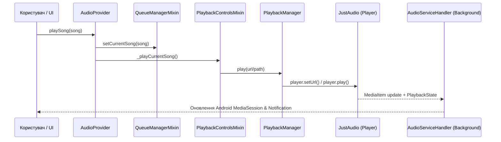

# Архітектура AudioProvider (architecture_audio_provider.md)

`AudioProvider` — це **головний оркестратор** стану аудіоплеєра у MusicFlow Mobile. Відповідно до суворого правила кодової бази (`< 200` рядків на файл), клас діє як фасад-композитор і делегує відповідальність через **модульну mixin-систему**.

---

## 🧩 Схема наслідування та міксини

Всі міксини розташовані в каталозі `lib/providers/audio/`:

```
AudioProvider (ChangeNotifier)
  ├── QueueManagerMixin         — черга треків, shuffle, repeat, додавання/видалення
  ├── PlaybackControlsMixin     — play/pause/seek/next/prev/stop/sleep timer
  ├── CrossfadeManagerMixin     — плавний перехід між треками (dual AudioPlayer)
  ├── LyricsManagerMixin        — завантаження, кешування та парсинг синхронізованих LRC текстів
  ├── PreferencesManagerMixin   — зберігання налаштувань у SharedPreferences (crossfade тощо)
  ├── StreamRecoveryMixin       — захист від розривів стріму та повторні спроби (Backoff)
  ├── PlayerSetupMixin          — ініціалізація та конфігурація екземплярів JustAudio
  └── AudioFocusManagerMixin    — взаємодія з нативним аудіофокусом Android (дзвінки, паузи)
```

---

## 🛠️ Як додати новий функціонал аудіоядра

1. Створи новий міксин у папці: `lib/providers/audio/my_feature_mixin.dart`.
2. Оголоси міксин із прив'язкою до ChangeNotifier:
   ```dart
   mixin MyFeatureMixin on ChangeNotifier {
     // Реалізація ізольованої логіки
   }
   ```
3. Підключи його до `AudioProvider`:
   ```dart
   class AudioProvider with ChangeNotifier, ..., MyFeatureMixin { ... }
   ```
4. **Суворе правило:** довжина файлу не повинна перевищувати 199 рядків (контролюється `file_length_test.dart`).

---

## 🔄 Потік відтворення треку



---

## 🎚️ Crossfade (Плавний перехід)

Запускається в `PlaybackControlsMixin`, коли залишок треку `remaining <= 3000ms`:

```
_checkCrossfade() → CrossfadeManagerMixin.startCrossfade()
  → Паралельно на двох апаратних плеєрах (_player1 та _player2):
    - fadeOut() на поточному треку (плавне експоненційне зниження гучності)
    - playSong(nextSong) → fadeIn() на новому треку
```

Вмикається та вимикається користувачем через `PreferencesManagerMixin.crossfadeEnabled`.

---

## ⚡ Ключові аспекти платформи

- **Спектральний аналізатор:** `visualizerStream` передається через `NativeVisualizerService.visualizerStream` (EventChannel від нативного Android C++/Kotlin коду).
- **AudioSession ID:** `sessionId` для апаратного `Visualizer` береться з нативного декодера `just_audio` відразу після старту стріму.
- **Персистентність:** Усі призначені для користувача налаштування зберігаються асинхронно через `SharedPreferences`.
