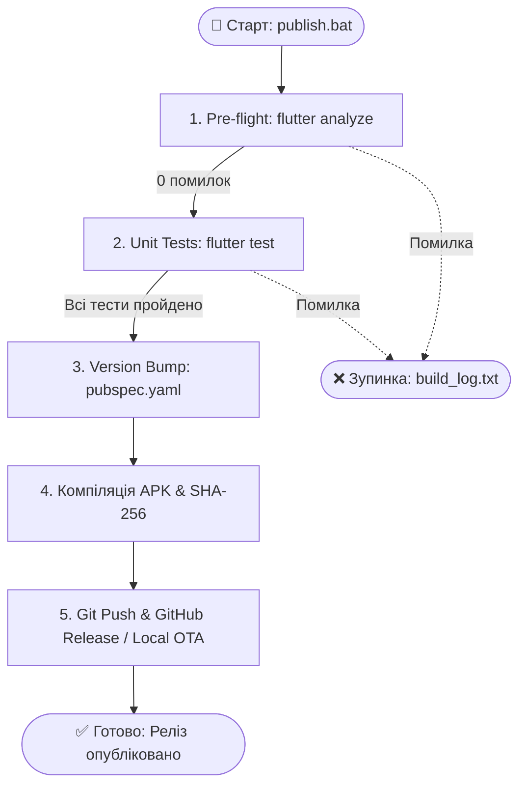

# 🚀 Збірка та Публікація в 1 Клік (ONE_CLICK_RELEASE.md)

Цей посібник описує процес автоматизованої збірки, тестування, версіонування та публікації нових релізів **MusicFlow Mobile** за допомогою єдиної команди.

---

## ⚡ Швидкий старт (1 Клік)

Для запуску повного інженерного циклу релізу на Windows:

1. **Запустіть скрипт:**
   - Двічі клацніть файл [`publish.bat`](../../publish.bat) у корені проєкту.
   - Або виконайте команду в терміналі:
     ```cmd
     .\publish.bat
     ```
2. **Дотримуйтесь підказок меню:**
   - Скрипт автоматично налаштує оточення (Adoptium Java 17 LTS), запустить перевірки та оновить версію.

---

## 🛠️ Архітектура конвеєра збірки

Скрипт `publish.bat` делегує виконання оркестратору [`publish_manager.py`](../../publish_manager.py), який послідовно виконує 5 етапів з повною валідацією:



### Деталізація етапів:

| Етап | Дія | Опис та критерії успіху |
|---|---|---|
| **[1/5] Статичний аудит** | `flutter analyze` | Перевірка лінтером. Реліз блокується за наявності будь-яких помилок синтаксису чи правил стилю. |
| **[2/5] Автоматичні тести** | `flutter test` | Прогін понад 66 тестів, включаючи ліміт `< 200` рядків у `lib/`, валідацію посилань у Markdown та коректність YAML. |
| **[3/5] Версіонування** | `pubspec.yaml` | Автоматичне підвищення Patch / Minor версії та номера збірки (`+build`), створення Git тегу `vX.Y.Z`. |
| **[4/5] Компіляція білда** | `flutter build apk` | Збірка `app-release.apk` із графічним рушієм Impeller, генерація контрольної суми SHA-256 для захисту від підміни. |
| **[5/5] Дистрибуція** | `gh release` / OTA | Автоматичне створення релізу на GitHub із прикріпленням APK та оновлення локального маніфесту `version.json`. |

---

## 📋 Системні вимоги для збірки

Для успішного виконання збірки на робочій станції мають бути встановлені:

* **Flutter SDK:** 3.24+ (перевірте `flutter --version`)
* **Java Development Kit:** Java 17 LTS (Adoptium Temurin підхоплюється автоматично)
* **Python:** 3.10+ (з утилітами стандартної бібліотеки)
* **GitHub CLI:** `gh` (виконайте `gh auth login` для публікації релізів у віддалений репозиторій)
* **Git:** встановлений та налаштований у системному `PATH`

---

## ☁️ Хмарна альтернатива (GitHub Actions CI/CD)

Якщо ви працюєте безпосередньо через веб-інтерфейс або не маєте локального Flutter SDK:
- У репозиторії налаштовано автоматичний робочий процес [`.github/workflows/ci.yml`](../../.github/workflows/ci.yml).
- Будь-який пуш або Pull Request у гілку `main` автоматично перевіряється, тестується та компілюється на віртуальних машинах GitHub.

---

## 🔍 Логування та усунення несправностей

- Усі логи виконання зберігаються у файлі `build_log.txt` у корені репозиторію.
- У разі виникнення помилки на будь-якому кроці конвеєр негайно зупиняється без пошкодження релізних файлів.
- Детальний регламент ручного випуску дивіться у [Чек-листі релізу](RELEASE_CHECKLIST.md).
